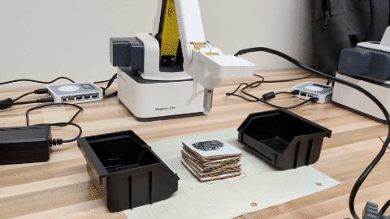

# Sorting picture cards with YOLO and a Dobot arm

<p align="center">
  
</p>

The robot picks picture cards off a stack one by one, looks at each one with a camera, and drops it on the right pallet: **food** goes to Pallet A, **vehicles** go to Pallet B. Anything else gets skipped.

This was Lab 3 (Object Detection with Palletization) in RAS 545 Robotic Systems I at Arizona State University, Fall 2025.

[](https://www.youtube.com/watch?v=-E9D1oegnaE)

## How it works

1. The arm moves to a hover point above the card stack.
2. The webcam watches the top card for up to 5 seconds while YOLOv8s (pretrained on COCO) runs on every frame. I only count detections above 0.45 confidence and keep the most confident one.
3. The label is mapped to a category:
   - food: banana, apple, sandwich, orange, broccoli, carrot, hot dog, pizza, donut, cake
   - vehicle: car, truck, bus, motorbike, bicycle, airplane
4. If it's food or a vehicle, the arm goes down, picks the card with suction, goes home, and releases it over the right pallet.
5. The stack gets shorter after every pick, so the pickup height drops by 8 mm each time to keep the suction cup on the next card.

`all_in_one.py` runs this for 6 cards in a row.

## Files

| File | What it does |
|---|---|
| `all_in_one.py` | The version I ran for the demo: detect, pick, sort, repeat |
| `main.py` | My first version. Keeps the camera running and sorts whenever it sees something. Has a `--simulate` flag so I could test it at home without the robot |
| `record_positions.py` | Walks you through moving the arm to home, pickup and both pallets, then saves them to `positions.json` |
| `calibrate_homography.py` | Click points in the camera image and pair them with robot X,Y to get a pixel-to-robot homography |
| `create_fake_homography.py` | Saves an identity homography so the simulate mode runs without a real calibration |
| `test_yolo.py`, `webcam_test.py`, `list_model_classes.py` | Small checks I used for the camera and the model |
| `positions.json` | The poses I recorded in the lab |

## Running it

```bash
pip install -r requirements.txt
python webcam_test.py          # make sure the camera opens (try index 1 or 2 if not)
python record_positions.py COM8
python all_in_one.py
```

`yolov8s.pt` downloads by itself the first time Ultralytics runs. The pick and drop points in the scripts are from my lab bench, so you'll need to record your own.

## A few choices I made

- The camera looks for a few seconds and keeps the most confident detection, instead of acting on a single frame.
- Anything below 0.45 confidence is ignored, and so is any class that isn't food or a vehicle. A card the robot isn't sure about stays on the stack instead of going to the wrong pallet.
- The robot goes back home between pick and drop, so it never swings low over the pallets.
